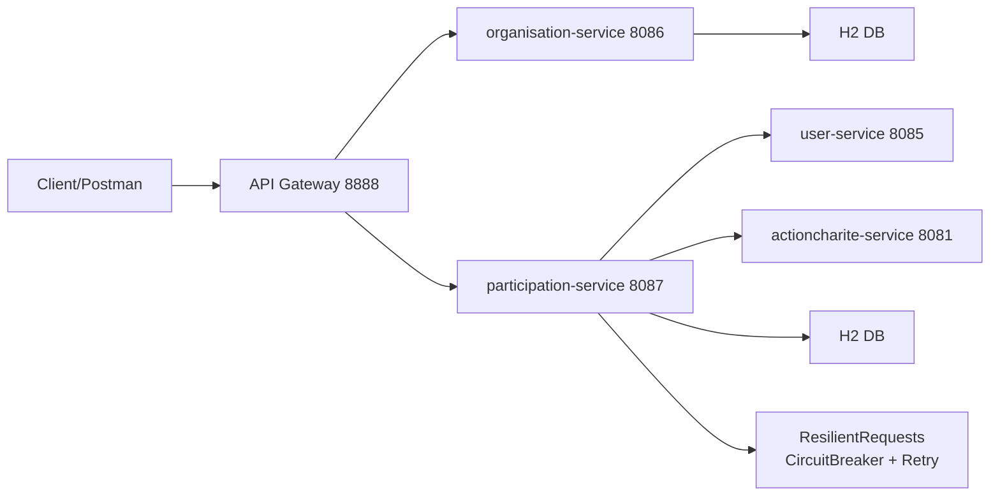

# Requirements

### Objectif
Implémenter la logique métier manquante pour `organisation-service` et `participation-service`, ainsi que la gestion globale des exceptions, en alignant strictement les conventions avec `don-service`.

### Scope

**In Scope :**
1. `organisation-service` : Entity, Repository, Service CRUD complet, Controller REST, GlobalExceptionHandler
2. `participation-service` : Entity avec idempotencyKey, Repository, Feign Clients, ResilientRequests avec `@CircuitBreaker`/`@Retry`, Service avec validation des références distantes et idempotence, Controller, GlobalExceptionHandler
3. `GlobalExceptionHandler` dans les deux services (et vérification que `don-service` est complet)
4. Compilation du projet multi-modules (`mvnw test-compile`)

**Out of Scope :**
- Modification de la configuration RabbitMQ dans `don-service` et `notification-service`
- Modification de `user-service` et `actioncharite-service` (sauf lecture pour comprendre les conventions)
- Publisher RabbitMQ dans `participation-service`
- Tests unitaires au-delà de la compilation

### Critères d'Acceptation

**organisation-service :**
- Entity `Organisation` avec validation Bean Validation (`@NotBlank`, `@Email`)
- `OrganisationRepository` extends `JpaRepository<Organisation, Long>`
- `RessourceIntrouvableException` extends `RuntimeException`
- `OrganisationService` avec CRUD complet
- `OrganisationController` avec POST (201), GET all (200), GET /{id} (200), PUT /{id} (200), DELETE /{id} (204)
- `GlobalExceptionHandler` avec 400, 404, 503

**participation-service :**
- Entity `Participation` avec `idempotencyKey` unique, `userId`, `actionId`, date, statut
- `ParticipationRepository` avec `findByldempotencyKey`
- Feign Clients vers `user-service` et `actioncharite-service` (mêmes conventions que `don-service`)
- `ResilientRequests` avec `@CircuitBreaker`/`@Retry` et fallbacks (tolérant pour lecture, strict pour création)
- `ParticipationService` : vérification idempotence avant tout appel distant, validation des ressources distantes, sauvegarde locale
- `ParticipationController` avec POST (201 avec idempotencyKey), GET all, GET /{id}
- `GlobalExceptionHandler` avec 400, 404, 503

**Compilation :**
- `mvnw test-compile` sans erreur sur le projet parent

### Conventions à Suivre (depuis `don-service`)

| Élément | Convention dans `don-service` |
|---------|-------------------------------|
| Package racine | `com.ecom.{servicename}` (ex: `com.ecom.donservice`) |
| Controller mapping | `@RequestMapping("/dons")` → `/organisations` et `/participations` |
| POST endpoint | `/new` avec `@RequestHeader("idempotencyKey")` |
| GET detail enrichi | `/{id}/detail` |
| DTO de création | `Create{Entity}Dto` avec `@NotNull`, `@Positive` |
| Exceptions | `RessourceIntrouvableException`, `ServiceExterneIndisponibleException` |
| Feign Client | `{Service}Request` interface + `{Service}Dto` |
| Résilience | `ResilientRequests` avec méthodes séparées pour création (strict) et lecture (tolérant) |
| GlobalExceptionHandler | Gère `IllegalArgumentException` (400), `FeignException` (404/502/503), `RessourceIntrouvableException` (404), `ServiceExterneIndisponibleException` (503), `ConstraintViolationException` (400) |
| Idempotence | `idempotencyKey` dans l'entité avec `unique = true`, vérifiée dans Service avant tout appel distant |

# Technical Design

### État Actuel des Services Cibles

**organisation-service (port 8086) :**
- `OrganisationServiceApplication.java` — `@EnableDiscoveryClient` présent, package `com.ecom.organisationservice`
- `application.properties` — Port 8086, Eureka, Config Server import
- `pom.xml` — Dépendances : `spring-boot-starter-web`, `spring-boot-starter-data-jpa`, `eureka-client`, H2, PostgreSQL
- **Manque** : Tout le reste (Entity, Repository, Service, Controller, Exception, GlobalExceptionHandler)
- **pom.xml manque** : `spring-boot-starter-validation` pour Bean Validation

**participation-service (port 8087) :**
- `ParticipationServiceApplication.java` — `@EnableDiscoveryClient` présent, package `com.ecom.participationservice`
- `application.properties` — Port 8087, Eureka, Config Server import
- `pom.xml` — Dépendances minimales : `spring-boot-starter-web`, `eureka-client`, `spring-boot-starter-test`
- **Manque** : Tout le reste + dépendances JPA, H2, OpenFeign, Resilience4j, validation

**don-service (référence) :**
- Structure complète : Entity (`Don.java`), Repository (`DonRepository.java`), Service (`DonService.java`), Controller (`DonController.java`)
- Feign : `UserRequest.java`, `ActionRequest.java`, `UserDto.java`, `ActionDto.java`
- Résilience : `ResilientRequests.java` avec `@CircuitBreaker`/`@Retry`, fallbacks strict/tolérant
- Exceptions : `GlobalExceptionHandler.java`, `RessourceIntrouvableException.java`, `ServiceExterneIndisponibleException.java`
- DTOs : `CreateDonDto.java` (validation), `DonDtoFull.java` (enrichi)
- Idempotence : `idempotencyKey` unique dans Entity, vérifiée dans Service avant tout appel distant
- `@EnableFeignClients` dans la classe Application

**user-service (cible Feign) :**
- `UserController.java` — `GET /users/{id}` retourne `UserDto` (id, name, email, etat)
- Données statiques en mémoire (Map)

**actioncharite-service (cible Feign) :**
- `ActionController.java` — `GET /actions/{id}` retourne `ActionDto` (id, titre, description, statut)
- Données statiques en mémoire (Map)

### Décisions Clés

1. **organisation-service** : CRUD pur, pas de Feign ni de résilience (pas de dépendance vers d'autres services)
2. **participation-service** : Suit exactement le pattern de `don-service` — Feign vers user-service et actioncharite-service, ResilientRequests avec fallbacks, idempotence dans l'entité
3. **Idempotence** : Comme `Don.java`, le champ `idempotencyKey` est directement dans l'entité `Participation` avec `@Column(unique = true)` — pas de table séparée
4. **Validation des références** : Comme `DonService.createDon()`, vérifier l'existence de l'utilisateur et de l'action via Feign avant de sauvegarder
5. **Fallbacks** : Strict (503) pour la création, tolérant (null) pour la lecture enrichie
6. **GlobalExceptionHandler** : Copie exacte du pattern de `don-service` avec les mêmes exceptions

### Changes à Apporter

#### 1. organisation-service — pom.xml
Ajouter la dépendance manquante :
- `spring-boot-starter-validation` (pour Bean Validation `@NotBlank`, `@Email`)

#### 2. organisation-service — Entity `Organisation`
```java
@Entity
public class Organisation {
    @Id @GeneratedValue(strategy = GenerationType.IDENTITY)
    private Long id;
    @NotBlank private String nom;
    private String description;
    @Email private String email;
    private String telephone;
    private String adresse;
    // getters/setters
}
```

#### 3. organisation-service — Repository
```java
public interface OrganisationRepository extends JpaRepository<Organisation, Long> {
}
```

#### 4. organisation-service — Exception
- `RessourceIntrouvableException` — Copie exacte de `don-service` (extends RuntimeException)

#### 5. organisation-service — Service
CRUD complet : `createOrganisation`, `getAllOrganisations`, `getOrganisationById` (lève `RessourceIntrouvableException`), `updateOrganisation`, `deleteOrganisation`

#### 6. organisation-service — Controller
```java
@RestController
@RequestMapping("/organisations")
@Validated
public class OrganisationController {
    @PostMapping("/new") -> 201 Created
    @GetMapping -> 200 OK
    @GetMapping("/{id}") -> 200 OK
    @PutMapping("/{id}") -> 200 OK
    @DeleteMapping("/{id}") -> 204 No Content
}
```

#### 7. organisation-service — GlobalExceptionHandler
Adapté de `don-service` sans les handlers Feign (pas de Feign) :
- `IllegalArgumentException` → 400
- `RessourceIntrouvableException` → 404
- `ConstraintViolationException` → 400

#### 8. participation-service — pom.xml
Ajouter les dépendances :
- `spring-boot-starter-data-jpa`, `spring-boot-starter-validation`
- `spring-cloud-starter-openfeign`, `spring-cloud-starter-loadbalancer`
- `spring-cloud-starter-circuitbreaker-resilience4j`
- `com.h2database:h2:runtime`

#### 9. participation-service — Application Class
Ajouter `@EnableFeignClients` (comme `DonServiceApplication`)

#### 10. participation-service — Entity `Participation`
```java
@Entity
public class Participation {
    @Id @GeneratedValue(strategy = GenerationType.IDENTITY)
    private Long id;
    private Long userId;
    private Long actionId;
    @Temporal(TemporalType.TIMESTAMP) private Date dateParticipation;
    @Enumerated(EnumType.STRING) private StatutParticipation statut;
    @Column(unique = true, nullable = false, length = 255) private String idempotencyKey;
}
```

#### 11. participation-service — Enum `StatutParticipation`
```java
public enum StatutParticipation { EN_ATTENTE, CONFIRMEE }
```

#### 12. participation-service — Repository
```java
public interface ParticipationRepository extends JpaRepository<Participation, Long> {
    Optional<Participation> findParticipationByIdempotencyKey(String idempotencyKey);
}
```

#### 13. participation-service — DTO de création
```java
public class CreateParticipationDto {
    @NotNull private Long userId;
    @NotNull private Long actionId;
}
```

#### 14. participation-service — Feign Clients
```java
@FeignClient(name = "user-service")
public interface UserRequest {
    @GetMapping("/users/{id}") UserDto getUserById(@PathVariable("id") Long id);
}

@FeignClient(name = "actioncharite-service")
public interface ActionRequest {
    @GetMapping("/actions/{id}") ActionDto getActionById(@PathVariable("id") Long id);
}
```

#### 15. participation-service — DTOs Feign
- `UserDto` — id, name, email, etat (identique à `don-service/feignClient/UserDto`)
- `ActionDto` — id, titre, description, statut (identique à `don-service/feignClient/ActionDto`)

#### 16. participation-service — ResilientRequests
Copie exacte du pattern de `don-service/ResilientRequests.java` :
- `getUserByIdCreation()` / `getUserByIdLecture()`
- `getActionByIdCreation()` / `getActionByIdLecture()`
- Fallbacks strict (503 via `ServiceExterneIndisponibleException`) pour création
- Fallbacks tolérant (retourne DTO partiel) pour lecture
- `estIndisponible()` pour détecter circuit ouvert / 503 / transport error

#### 17. participation-service — Exceptions
- `RessourceIntrouvableException` — Copie de `don-service`
- `ServiceExterneIndisponibleException` — Copie de `don-service` avec `@ResponseStatus(HttpStatus.SERVICE_UNAVAILABLE)`

#### 18. participation-service — Service
```java
@Service
public class ParticipationService {
    // createParticipation(p, idempotencyKey) :
    // 1. Valider idempotencyKey, vérifier doublon
    // 2. getUserByIdCreation (strict) → vérifier etat=1
    // 3. getActionByIdCreation (strict) → vérifier statut=OUVERTE
    // 4. Sauvegarder avec date et statut EN_ATTENTE
    // getParticipationById → RessourceIntrouvableException si absent
    // getAllParticipations
}
```

#### 19. participation-service — Controller
```java
@RestController
@RequestMapping("/participations")
@Validated
public class ParticipationController {
    @PostMapping("/new") -> 201 Created (avec @RequestHeader idempotencyKey)
    @GetMapping -> 200 OK
    @GetMapping("/{id}") -> 200 OK
}
```

#### 20. participation-service — GlobalExceptionHandler
Copie exacte de `don-service/GlobalExceptionHandler.java` :
- `IllegalArgumentException` → 400
- `FeignException.NotFound` → 404
- `FeignException` → 502/503
- `ConstraintViolationException` → 400
- `RessourceIntrouvableException` → 404
- `ServiceExterneIndisponibleException` → 503

### Architecture Diagram



### Risques

1. **participation-service pom.xml** : Les dépendances OpenFeign et Resilience4j ne sont pas présentes — ajout nécessaire
   - **Mitigation** : Copier les dépendances exactes de `don-service/pom.xml`

2. **organisation-service pom.xml** : `spring-boot-starter-validation` manquant pour Bean Validation
   - **Mitigation** : Ajouter la dépendance avant de créer l'Entity

3. **Conflit de noms** : `UserDto` et `ActionDto` existent dans `don-service/feignClient/` avec la même structure
   - **Mitigation** : Recréer les mêmes DTOs dans `participation-service/feignClient/` (packages isolés)

4. **user-service et actioncharite-service statiques** : Les données sont en mémoire (Map), pas en base
   - **Mitigation** : Accepter pour le jalon — les Feign Clients fonctionnent avec les endpoints existants

# Testing

### Validation par compilation
- `mvnw test-compile` sur le projet parent doit réussir sans erreur

### Scénarios de test — organisation-service

**CRUD :**
1. `POST /organisations/new` avec body `{"nom":"Test","email":"test@test.com"}` → 201 Created
2. `GET /organisations` → 200 OK, liste non vide
3. `GET /organisations/1` → 200 OK, organisation retournée
4. `PUT /organisations/1` avec body mis à jour → 200 OK
5. `DELETE /organisations/1` → 204 No Content
6. `GET /organisations/999` → 404 Not Found (RessourceIntrouvableException)
7. `POST /organisations/new` avec `{"nom":""}` → 400 Bad Request (validation @NotBlank)
8. `POST /organisations/new` avec `{"email":"invalid"}` → 400 Bad Request (validation @Email)

### Scénarios de test — participation-service

**Création avec validation :**
1. `POST /participations/new` avec `{"userId":1,"actionId":1}` + header `idempotencyKey: key-1`
   - **Expected** : 201 Created
2. Même requête avec la même clé `key-1`
   - **Expected** : 201 Created, même résultat (idempotence, pas de doublon)
3. `POST /participations/new` avec `{"userId":1,"actionId":1}` + header `idempotencyKey: key-2`
   - **Expected** : 201 Created, nouvelle participation
4. `POST /participations/new` avec `{"userId":3,"actionId":1}` (utilisateur suspendu)
   - **Expected** : 400 Bad Request, "Utilisateur suspendu"
5. `POST /participations/new` avec `{"userId":1,"actionId":3}` (action clôturée)
   - **Expected** : 400 Bad Request, "Action clôturée"
6. `POST /participations/new` avec `{"userId":999,"actionId":1}` (utilisateur inexistant)
   - **Expected** : 404 Not Found

**Lecture :**
7. `GET /participations` → 200 OK, liste
8. `GET /participations/1` → 200 OK
9. `GET /participations/999` → 404 Not Found

**Résilience :**
10. Arrêter user-service, `POST /participations/new` → 503 Service Unavailable (fallback strict)
11. Redémarrer user-service, `POST /participations/new` → 201 Created (restauration)

### Edge Cases
1. **IdempotencyKey nulle** : POST sans header → 400 Bad Request
2. **IdempotencyKey trop longue** : > 255 caractères → 400 Bad Request
3. **Circuit Breaker ouvert** : Après plusieurs échecs sur user-service, retour rapide 503
4. **Service indisponible** : actioncharite-service arrêté → 503 en création

### Step 1: Corriger les pom.xml (organisation-service + participation-service)
### Step 2: Implémenter organisation-service (Entity, Repository, Exception, Service, Controller, GlobalExceptionHandler)
### Step 3: Implémenter participation-service (Entity, Enum, Repository, DTOs, Feign Clients, ResilientRequests, Exceptions, Service, Controller, GlobalExceptionHandler)
### Step 4: Compiler et vérifier le projet (`mvnw test-compile`)
