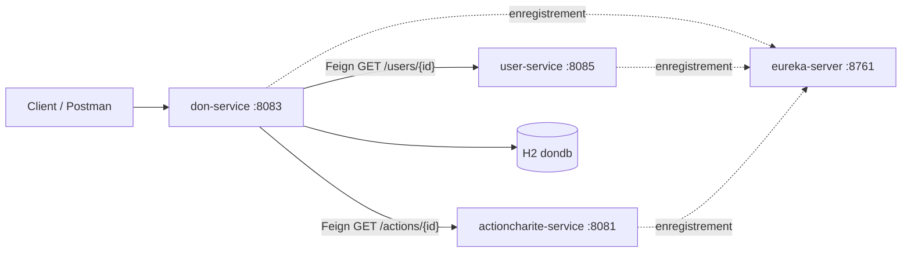

# GestionChariteMicro
#  Plateforme Microservices de Gestion Caritative

`CharityManager` est une application distribuée basée sur une architecture **Microservices** avec Spring Boot et Spring Cloud. Elle permet de gérer de manière centralisée et découplée les associations, les actions de solidarité, les dons, les utilisateurs ainsi que le système de notification.

---

## 🏗️ Architecture Technique & Stack
- **Framework Principal :** Spring Boot (v3.3.5)
- **Écosystème Cloud :** Spring Cloud (v2023.0.3)
- **Langage :** Java 17
- **Gestion de Build :** Maven (Architecture multi-modules)
- **Communication :** Synchrone (OpenFeign) & Asynchrone
- **Découverte de services :** Netflix Eureka Server
- **Gestion de configuration :** Spring Cloud Config Server
- **Routage :** Spring Cloud Gateway

---

## 📦 Structure des Microservices (Isolation des bases de données)

L'architecture suit strictement le pattern *Database per Service* :

| Nom du Module | Port par défaut | Rôle principal |
| :--- | :---: | :--- |
| **`eureka-server`** | `8761` | Annuaire centralisé pour l'enregistrement et la découverte des services. |
| **`config-server`** | `9999` | Centralisation des fichiers de configuration externes. |
| **`gateway-source`** | `8888` | Point d'entrée unique (API Gateway) avec routage dynamique. |
| **`user-service`** | *Dynamique* | Gestion des utilisateurs, profils et authentification. |
| **`organisation-service`**| *Dynamique* | Gestion des associations et ONG partenaires. |
| **`actioncharite-service`**| *Dynamique* | Gestion des campagnes et événements de solidarité. |
| **`don-service`** | *Dynamique* | Traitement et suivi des transactions de dons. |
| **`participation-service`**| *Dynamique* | Gestion des inscriptions/participations aux actions. |

---

## 🚀 Guide de Démarrage

Pour lancer l'infrastructure correctement, respectez impérativement cet ordre de démarrage :

1. **Discovery Server (Eureka)** : Lancer `EurekaServerApplication` (Port `8761`)
2. **Config Server** : Lancer `ConfigServerApplication` (Port `9999`)
3. **API Gateway** : Lancer `GatewaySourceApplication` (Port `8888`)
4. **Microservices Métier** (`user-service`, `organisation-service`, `actioncharite-service`, `don-service`, etc.)

---

## 🧪 Validation & Tests
- **Tableau de bord Eureka :** [http://localhost:8761](http://localhost:8761)
- **Point d'entrée API Gateway :** [http://localhost:8888](http://localhost:8888)
## Jalon 4 : Communication synchrone avec OpenFeign

`don-service` communique en synchrone avec `user-service` et `actioncharite-service` grâce à **OpenFeign**, via la découverte de services **Eureka**.

### Architecture

### Services

| Service | Port | Rôle |
|---|---|---|
| eureka-server | 8761 | Registre de services |
| user-service | 8085 | Fournit les utilisateurs (`GET /users/{id}`) |
| actioncharite-service | 8081 | Fournit les actions de charité (`GET /actions/{id}`) |
| don-service | 8083 | Crée et consulte les dons |

### Clients Feign (don-service)

- `UserRequest` : `@FeignClient(name = "user-service")`, `GET /users/{id}`
- `ActionRequest` : `@FeignClient(name = "actioncharite-service")`, `GET /actions/{id}`

Les appels passent par Eureka (nom du service) et non par la Gateway : le chemin est donc sans préfixe de service.

### API de don-service

| Méthode | URL | Description |
|---|---|---|
| POST | `/dons/new` | Crée un don (en-tête `idempotencyKey` obligatoire) |
| GET | `/dons/{id}` | Don enregistré en base locale |
| GET | `/dons/{id}/detail` | Don enrichi : nom et email de l'utilisateur, titre de l'action |

### Règles de création d'un don

1. La clé `idempotencyKey` est validée et un doublon est rejeté **avant tout appel Feign**.
2. L'utilisateur doit exister et être actif (`etat = 1`).
3. L'action doit exister et être `OUVERTE`.
4. Le don est enregistré avec la date et le statut `EN_ATTENTE`.

### Gestion des erreurs

| Cas | Réponse |
|---|---|
| Refus métier (clé invalide, doublon, utilisateur suspendu, action clôturée) | 400 |
| Ressource introuvable (utilisateur, action ou don) | 404 |
| Échec de communication ou service indisponible | 503 |
| Autre erreur HTTP du service distant | 502 |

### Données de test

- Utilisateurs : 1 et 2 actifs, 3 suspendu.
- Actions : 1 et 2 ouvertes, 3 clôturée.
- La base H2 de `don-service` est en mémoire : elle est vidée à chaque redémarrage.

### Tests Postman

Les captures (requêtes et réponses, cas de réussite et d'échec) sont dans `docs/postman/`.